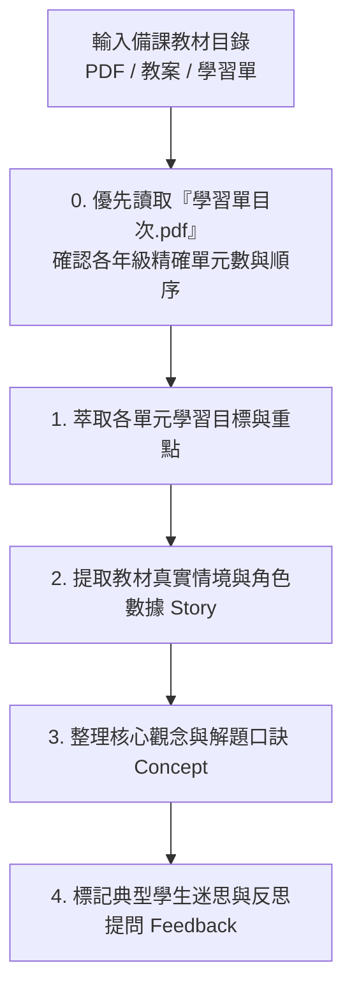

# 數學備課教材互動網頁化開發技能指引 (making_math_interaction.md)

本文件匯整自「木新思達國小 1~6 年級數學互動教學平台（康軒版 57 單元 ＋ 南一版 56 單元，共 113 單元、565 份測驗卷）」的完整實戰架構與開發經驗。本技能旨在提供 AI Agent 與教師/工程師在面對**任何年級、任何出版社（康軒、南一、翰林等）之新備課教材**時，能以標準化、模組化且具高度教學效能的方式，快速產出高互動性網頁並整合至現有系統中。

---

## 1. 核心教學設計理念：CPA 與自適應互動

所有數學互動單元皆嚴格依據**新加坡數學與現代認知心理學的 CPA 教學法**：

1. **Concrete（具體物操弄）**：
   - 學生必須能先操作「有形實物」或「虛擬教具」（如：拖拉萬以內積木、移動量尺、點選十格陣、旋轉時鐘指針、分配披薩切片、注水入量杯、圓規張開半徑畫圓、射擊固定靶統計周界內外部）。
2. **Pictorial（圖像化表徵）**：
   - 透過幾何視覺化將操作轉化為圖像認知（如：雙折線圖與波浪省略線、百數表骰子展開圖、長方體 3D 透視圖與 6 面展開圖切換、數線跳躍、面積割補方格網、扇形圓心角填色）。
3. **Abstract（符號化抽象）**：
   - 引導至算式記錄、橫式運算、時間複名數直式乘除進退位、代數規律或數學符號（支援 OMML / MathML 標準渲染）。

---

## 2. 備課教材解析與核心觀念萃取 SOP (Step 1)

當收到新學期、新出版社或新單元的備課教材資料夾（如課前診斷學習單、單元學習單、八格活動單、素養學習單 PDF 文件）時，執行以下五步解析：



### 2.1 備課目錄掃描與萃取必備要素
- **UTF-8 編碼防亂碼**：在 Windows PowerShell 掃描中文備課目錄前，務必先執行 `[Console]::OutputEncoding = [System.Text.Encoding]::UTF8`，避免中文檔名亂碼。
- **優先核對官方目次（TOC）**：先讀取各年級 `00_X上數學學習單目次.pdf`，確認該出版社各年級的精確單元總數（例如：南一版 6上為 8 單元、康軒版 6上為 9 單元）與單元順序。
- **提取教材真實生活情境（3 組預設任務 ＋ 隨機出題）**：將備課學習單中的真實角色與數據轉化為情境按鈕（例如：南一版「Follow Me 神射手棠棠射擊固定靶」、「小人國設計家圓規畫圓與修理盾牌」、「湯基郎百數表骰子展開圖」、「南北溫差大雙折線圖」、「幸福動物園運動大會時間乘除」、「濃情巧克力防震壓條與表面積」）。
- **核心觀念解析點（Concept Points）**：2~3 點關鍵定義、算則原由或解題口訣。
- **反思性思考提問（Reflection Prompt）**：啟發學生思考「為什麼要這樣算？」而非單純背公式。

---

## 3. 多出版社共構與仿三年級標準頁面架構 (Step 2)

### 3.1 單一網站多出版社雙軌架構（Shared + Custom Hybrid Mapping）
在同一網站中同時支援多個出版社版本（如 `📘 康軒版` 與 `📗 南一版`）時，採用**「共享底座 ＋ 專屬擴充」雙軌映射架構**（實作於 `web/app_nanyi.js`）：

1. **課綱共同單元（`type: 'shared'`）**：
   - 映射至現有高互動 CPA 教具區段（`refSec`），並在切換時先將原版標題與按鈕快取於 `origBannerCache`。
   - 動態將 `.unit-banner` 的標題、副標題（`bannerSub`）與測驗按鈕替換為新出版社的單元順序、名稱與學習單情境描述；切回原出版社時從 `origBannerCache` 100% 無損還原。
2. **出版社獨有／特色單元（`type: 'custom'`）**：
   - 針對該出版社特有單元（如南一 2上 U10 平面圖形、3上 U9 圓、4上 U7 數量關係、5上 U1 折線圖、5上 U9 時間的乘除、5上 U10 正方體和長方體），建立獨立 `<section id="ny_gX_unitY" class="unit-section">` 與專屬渲染器 `renderNyGXUY()`。
3. **動態單元導覽列重建（`rebuildAllUnitNavs(pub)`）**：
   - 快取初始導覽列 HTML（`origNavHTMLCache`），根據當前選擇的出版社動態渲染 1上～6上 導覽按鈕與測驗中心入口，並自動適配各版本不同的單元數量（`getMaxUnits()`）。

### 3.2 仿三年級標準卡片 HTML 架構
為保證全站各版本、各年級、各單元有一致的使用者體驗與自適應排版，每個單元的 HTML 必須嚴格遵循**標準卡片結構**：

```html
<!-- 單元主容器：注意嚴禁在標籤加 style="display:none;" -->
<section id="ny_gX_unitY" class="unit-section">

  <!-- 1. 單元標題橫幅 (Banner) -->
  <div class="unit-banner">
    <div class="unit-banner-info">
      <h2>🎯 【南一版 X上】第 Y 單元：單元名稱</h2>
      <p>結合教材學習單核心重點摘要與生活實踐目標！</p>
    </div>
    <div class="submode-switcher">
      <button class="btn btn-Amber" onclick="openNyUnitQuiz('X上', Y)">📝 參加南一第Y單元測驗 (5份卷)</button>
    </div>
  </div>

  <!-- 2. 主工作卡片 (Workspace Card) -->
  <div class="workspace-card">
    
    <!-- 2.1 課本案例任務卡 (Story Prompt) -->
    <div class="story-prompt">
      <div class="story-text">
        <span class="story-badge">學習單情境任務</span>
        <span id="nyGXUYTaskText">【生活情境題目描述...】</span>
      </div>
      <div style="display:flex; gap:0.4rem; flex-wrap:wrap;">
        <button class="btn btn-Amber" onclick="setNyGXUYPreset(參數1, '情境說明A')">範例1：情境A</button>
        <button class="btn btn-Amber" onclick="setNyGXUYPreset(參數2, '情境說明B')">範例2：情境B</button>
        <button class="btn btn-Amber" onclick="setNyGXUYPreset(參數3, '情境說明C')">範例3：情境C</button>
        <button class="btn btn-primary" onclick="randomNyGXUYTask()">🎲 隨機出題</button>
      </div>
    </div>

    <!-- 2.2 核心觀念深度解析卡 (Concept Card) -->
    <div class="g6-concept-card" style="margin-bottom:1rem; padding:1rem 1.25rem;">
      <div class="g6-concept-title" style="font-size:1.05rem; margin-bottom:0.5rem;">
        💡 核心觀念：單元關鍵定義與解題口訣
      </div>
      <div style="font-size:0.95rem; color:#334155; line-height:1.7;">
        1. <strong>核心概念 1</strong>：具體說明與觀念原由。<br/>
        2. <strong>解題口訣 2</strong>：直觀記憶與邏輯推導。
      </div>
    </div>

    <!-- 2.3 具體教具互動操作區 (Manipulative Display) -->
    <div id="nyGXUYDisplay" style="margin-bottom:1rem;"></div>

    <!-- 2.4 啟發思考反饋提示橫幅 (Feedback Banner) -->
    <div class="feedback-banner success">
      💡 操作提示與思考提問：引導學生動手操作並深入思考本單元關鍵本質。
    </div>

  </div>
</section>
```

---

## 4. 原生互動教具開發範式 (Step 3)

為確保秒開、iPad 觸控與跨平臺穩定性，教具一律採用 **Vanilla JavaScript (ES6+) + 原生 SVG / HTML5 Canvas**：

### 4.1 狀態機設計
每個年級或出版社建立獨立狀態物件（如 `g1State`, `g2State`, `nyState`）：
```javascript
const nyState = {
  g2u10: { mode: 'target', shots10: 4, shots6: 3, shots2: 5, shots0: 6, story: '...' },
  g3u9: { radius: 3, showFold: true, story: '...' }
};
```

### 4.2 隨機出題與預設按鈕標準模式
```javascript
function setNyGXUYPreset(val, storyText) {
  nyState.gXuY.val = val;
  const textEl = document.getElementById('nyGXUYTaskText');
  if (textEl) textEl.innerHTML = storyText;
  renderNyGXUY();
  if (typeof playTone === 'function') playTone(523.25, 0.08);
}

function randomNyGXUYTask() {
  const randVal = Math.floor(Math.random() * 20) + 1;
  setNyGXUYPreset(randVal, `【隨機挑戰】系統為你抽出一道全新任務：請找出 <strong>${randVal}</strong> 的解法！`);
}
```

---

## 5. 線上評量測驗卷規範與結構驗證 (Step 4)

每個單元編製 **5 份標準測驗卷**（每卷 5 題，每題 20 分，滿分 100 分）：
1. **第 1 卷：單元學前檢測卷**（診斷舊經驗與課前暖身）
2. **第 2 卷：基礎能力練習卷**（核心概念精熟）
3. **第 3 卷：隨堂練習單**（課堂核心代表題）
4. **第 4 卷：單元學後檢測卷**（單元綜合總評量）
5. **第 5 卷：數學素養與資優挑戰卷**（Follow Me 生活素養與進階應用題）

### 題庫結構範式（二維陣列：`bank[unitNum][paperIdx]`）
> ⚠️ 注意：`quiz.js` 讀取題目的標準路徑為 `bank[u][pIdx]`（其中 `u` 為單元編號 `"1"`~`"10"`，`pIdx` 為 `0`~`4` 的陣列索引），因此每個單元的題庫必須是包含 5 個子陣列的二維陣列：
```javascript
const QUIZ_BANK_SAMPLE = {
  "1": [
    // 卷 1 (pIdx = 0)：單元學前檢測卷 (5 題)
    [
      { type: "mc", q: "單選題題幹", options: ["選項A", "選項B", "選項C", "選項D"], ans: "選項A", explain: "詳細解析" },
      { type: "tf", q: "是非題陳述", ans: "O", explain: "解析說明" },
      { type: "cmp", q: "比大小：", left: "1/3", right: "1/4", ans: ">", explain: "同分子分數分母越小值越大" },
      { type: "fill", q: "填空題計算：", ans: "15", unitLabel: "公分", explain: "解析說明" },
      { type: "mc", q: "第5題題幹", options: ["1", "2", "3", "4"], ans: "2", explain: "解析說明" }
    ],
    // 卷 2 (pIdx = 1) ~ 卷 5 (pIdx = 4)...
  ]
};
```

---

## 6. 避坑防護與最佳實踐（Critical Anti-Patterns & Rules）

此部分為歷次跨年級與多出版社擴充時獲得的重大核心教訓，**所有開發者與 AI Agent 必須嚴格遵守**：

> [!CAUTION]
> ### 1. 嚴禁在 `<section>` 標籤加上行內樣式 `style="display:none;"`
> - **原因**：標籤上的 Inline Style 優先級為 1000，遠大於 CSS Class 規則 `.unit-section.active { display: block; }`（權重 20）。
> - 若寫上 `style="display:none;"`，即使 JavaScript 成功加入 `.active` 類別，**瀏覽器仍會強制隱藏整個單元**，導致畫面空白看不到教學內容！
> - **正確做法**：HTML 只宣告 `<section id="gX_unitY" class="unit-section">`，並在切換時同步設定：
>   ```javascript
>   sec.classList.toggle('active', isTarget);
>   sec.style.display = (isTarget ? 'block' : 'none');
>   ```

> [!WARNING]
> ### 2. 跨檔案題庫與狀態變數的作用域陷阱（`const` / `let` vs `window`）
> - **原因**：在瀏覽器中，頂層宣告的 `const QUIZ_BANK_G1 = ...` 或 `let activePublisher = ...` **不會自動成為 `window` 物件的屬性**（即 `window.QUIZ_BANK_G1` 會是 `undefined`）！
> - **正確做法**：
>   1. 定義端必須顯式掛載至 `window`：`if (typeof window !== 'undefined') window.activePublisher = activePublisher;`。
>   2. 跨檔案讀取端（如 `quiz_nanyi.js` 引用各年級基礎題庫時）必須優先檢查全域詞法環境，再檢查 `window`：
>      ```javascript
>      const kx1 = (typeof QUIZ_BANK_G1 !== 'undefined') ? QUIZ_BANK_G1 : ((typeof window !== 'undefined' && window.QUIZ_BANK_G1) ? window.QUIZ_BANK_G1 : {});
>      ```
>   3. `index.html` 的 `<script>` 載入順序中，衍生題庫（如 `quiz_nanyi.js`）必須放在所有基礎題庫（`quiz.js`, `quiz_g1.js`, `quiz_g2.js`, `quiz_g5.js`, `quiz_g6.js`）**之後**載入。

> [!IMPORTANT]
> ### 3. 靜態資源引用必須帶有 Cache-Busting 版本戳記
> - 瀏覽器強快取（Disk/Memory Cache）會導致使用者端即使重新整理依然讀取舊版 JS/CSS。
> - 所有引入的本機資源（CSS 與 JS）每次更新均需同步推進全站版本參數：
>   ```html
>   <script src="quiz_nanyi.js?v=20261109_ny1"></script>
>   <script src="app_nanyi.js?v=20261109_ny1"></script>
>   ```

> [!TIP]
> ### 4. 頁面初始化必須支援三維 URL 查詢參數直達路由（`?pub=`、`?grade=`、`?unit=`）
> - 解決使用者因本機 `localStorage` 鎖定在舊版本或舊年級而誤以為新內容未生效的問題。
> - 在 `app.js` 的 `DOMContentLoaded` 中依序解析 `?pub=nanyi|kangxuan`、`?grade=1~6` 與 `?unit=1~10`，強制切換至目標出版社、年級與單元。

> [!WARNING]
> ### 5. Git 提交過濾與 Wrangler 4.x 部署避坑規範
> - **過濾大型檔案**：GitHub 限制單一檔案超過 100MB 阻擋推送，`.gitignore` 必須排除 `*.pdf`, `*.iso`, `*.mp4`, `*.zip`。
> - **Commit Message 編碼**：執行 `wrangler pages deploy` 時，建議顯式傳入英文 ASCII `--commit-message="feat(...): ..."`，避免 Windows 主控台 Big5/UTF-8 轉換造成 Cloudflare API 拒絕。
> - **`.wrangler/tmp` 舊暫存目錄清理中斷防護**：`wrangler 4.x` 在啟動部署時會呼叫 `sweepStaleWranglerTmpDirs` 嘗試刪除 `.wrangler/tmp` 下超過 24 小時的舊資料夾；在受限沙盒或 OneDrive 目錄下，`fs.rmSync` 可能觸發底層權限中斷導致無報錯退出（Exit Code 1）。部署時可透過 Node `-r preload.js` 將 `.wrangler/tmp` 的 `readdirSync` 返回空陣列並將 `rmSync` 設為 no-op，且從 `web/` 目錄執行 `pages deploy .` 以確保 `web/functions`（Cloudflare D1 API）一併編譯上傳。

---

## 7. 部署、自動化驗證與收工標準流程 (End of Work SOP)

開發新單元、新出版社或修改現有架構後，必須按以下 5 步標準收工：

1. **語法與全題庫結構自動化驗證 (Syntax & Bank Integrity Check)**：
   ```powershell
   node --check web/app.js; node --check web/app_nanyi.js; node --check web/quiz.js; node --check web/quiz_nanyi.js
   ```
   並使用 Node `vm` 腳本驗證所有年級、所有單元的題庫皆滿足 `papers.length === 5`、每卷 `p.length === 5`、無空題目，且所有映射之 `<section id="...">` 均存在於 `web/index.html` 且無 inline `display:none`。
2. **多專案同步 (Sync Projects)**：
   - 將更新後之 `web/*`、`README.md` 與技能文件同步至 `Grade4` 與 `Grade3` 儲存庫。
3. **Git 提交與 GitHub 推播備份**：
   ```powershell
   git add .
   git commit -m "feat(scope): summary of changes"
   git push origin master
   ```
4. **Cloudflare Pages Production 發布（含 D1 Functions 打包）**：
   ```powershell
   cd web
   node -r "<preload_fix_path>" "<wrangler_cli_path>" pages deploy . --project-name kangxuan-grade3-math --branch main --commit-dirty=true --commit-message="feat(nanyi): deploy interactive curriculum"
   ```
5. **生產主網址即時 `curl` 驗證**：
   ```powershell
   curl.exe -s -I "https://kangxuan-grade3-math.pages.dev/app_nanyi.js?v=20261109_ny1"
   curl.exe -s "https://kangxuan-grade3-math.pages.dev/?pub=nanyi&grade=5&unit=1" | Select-String "app_nanyi.js"
   ```
