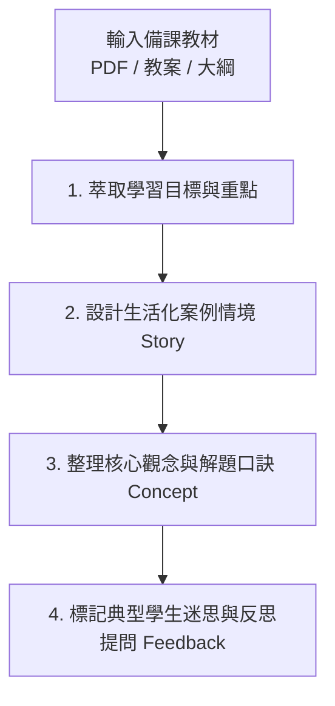

# 數學備課教材互動網頁化開發技能指引 (making_math_interaction.md)

本文件匯整自「木新思達國小 1~6 年級數學互動教學平台」的完整實戰架構與開發經驗。本技能旨在提供 AI Agent 與教師/工程師在面對**任何年級、任何出版社（康軒、南一、翰林等）之新備課教材**時，能以標準化、模組化且具高度教學效能的方式，快速產出高互動性網頁並整合至現有系統中。

---

## 1. 核心教學設計理念：CPA 與自適應互動

所有數學互動單元皆嚴格依據**新加坡數學與現代認知心理學的 CPA 教學法**：

1. **Concrete（具體物操弄）**：
   - 學生必須能先操作「有形實物」或「虛擬教具」（如：拖拉萬以內積木、移動量尺、點選十格陣、旋轉時鐘指針、分配披薩切片、注水入量杯）。
2. **Pictorial（圖像化表徵）**：
   - 透過幾何視覺化將操作轉化為圖像認知（如：長條圖、數線跳躍、線段倍數圖、面積方格網、扇形圓心角填色）。
3. **Abstract（符號化抽象）**：
   - 引導至算式記錄、橫式運算、直式借位進位、代數關係或數學符號（支援 OMML / MathML 標準渲染）。

---

## 2. 備課教材解析與核心觀念萃取 SOP (Step 1)

當收到新學期或新單元的備課教材（PDF 文件、PPT 或課綱大綱）時，執行以下四步解析：



### 2.1 萃取清單必備要素
- **單元名稱與適用年級**：例如「4上 第 3 單元：角度與旋轉」。
- **3~4 組具體生活情境任務**：將課本例題轉化為生活角色任務（例如：「小達在文具店量尺」、「動物園分蘋果」、「烘焙坊切蛋糕」）。
- **核心觀念解析點（Concept Points）**：3 點關鍵理論、算則原由或口訣。
- **反思性思考提問（Reflection Prompt）**：啟發學生思考「為什麼要這樣算？」而非單純背公式。

---

## 3. 仿三年級標準教學頁面架構規範 (Step 2)

為保證全站各年級各單元有一致的使用者體驗與極佳的自適應排版，每個單元的 HTML 必須嚴格遵循**標準卡片結構**：

```html
<!-- 單元主容器：注意嚴禁在標籤加 style="display:none;" -->
<section id="gX_unitY" class="unit-section">

  <!-- 1. 單元標題橫幅 (Banner) -->
  <div class="unit-banner">
    <div class="unit-banner-info">
      <h2>📐 [年級代號] 第 Y 單元：單元名稱</h2>
      <p>結合教材核心重點摘要與生活實踐目標！</p>
    </div>
    <div class="submode-switcher">
      <button class="btn btn-Amber" onclick="openGXUnitQuiz(Y)">📝 參加本單元測驗 (5份卷)</button>
    </div>
  </div>

  <!-- 2. 主工作卡片 (Workspace Card) -->
  <div class="workspace-card" style="margin-top:1rem; border-left:5px solid #F59E0B;">
    
    <!-- 2.1 課本案例任務卡 (Story Prompt) -->
    <div class="story-prompt" style="margin-bottom:0.75rem;">
      <div class="story-text">
        <span class="story-badge">課本案例任務</span>
        <span id="gXUYTaskText">【生活情境題目描述...】</span>
      </div>
      <div style="display:flex; gap:0.5rem; flex-wrap:wrap; margin-top:0.6rem;">
        <button class="btn btn-Amber" onclick="setGXUYPreset(參數1, '情境說明A')">情境按鈕 1</button>
        <button class="btn btn-Amber" onclick="setGXUYPreset(參數2, '情境說明B')">情境按鈕 2</button>
        <button class="btn btn-Amber" onclick="setGXUYPreset(參數3, '情境說明C')">情境按鈕 3</button>
        <button class="btn btn-primary" onclick="randomGXUYTask()">🎲 隨機出題</button>
      </div>
    </div>

    <!-- 2.2 核心觀念深度解析卡 (Concept Card) -->
    <div class="g6-concept-card" style="margin: 0.85rem 0; border-left-color: #3B82F6;">
      <div class="g6-concept-title">
        💡 單元核心觀念精解
      </div>
      <ul style="padding-left:1.25rem; line-height:1.75; font-size:0.95rem; color:#334155; margin:0.35rem 0 0 0;">
        <li><strong>核心概念 1</strong>：具體說明與觀念原由。</li>
        <li><strong>解題口訣 2</strong>：直觀記憶與邏輯推導。</li>
        <li><strong>注意事項 3</strong>：避免常見錯誤與迷思。</li>
      </ul>
    </div>

    <!-- 2.3 具體教具互動操作區 (Manipulative Display) -->
    <div style="margin-top:1rem;">
      <div id="gXUYDisplay"></div>
    </div>

    <!-- 2.4 啟發思考反饋提示橫幅 (Feedback Banner) -->
    <div class="feedback-banner" style="margin-top:1rem;">
      💡 思考提問：引導學生深入思考本單元關鍵本質的問題。
    </div>

  </div>
</section>
```

---

## 4. 原生互動教具開發範式 (Step 3)

為確保秒開、iPad 觸控與跨平臺穩定性，教具一律採用 **Vanilla JavaScript (ES6+) + 原生 SVG / HTML5 Canvas**：

### 4.1 狀態機設計
每個年級建立獨立狀態物件（如 `g1State`, `g2State`...）：
```javascript
const gXState = {
  currentUnit: 1,
  u1: { count: 5, mode: 'default' },
  u2: { valA: 10, valB: 5 }
};
```

### 4.2 隨機出題與預設按鈕標準模式
```javascript
function setGXUYPreset(val, storyText) {
  gXState.uY.val = val;
  const textEl = document.getElementById('gXUYTaskText');
  if (textEl) textEl.innerHTML = storyText;
  renderGXUY();
  if (typeof playTone === 'function') playTone(523.25, 0.08);
}

function randomGXUYTask() {
  const randVal = Math.floor(Math.random() * 20) + 1;
  setGXUYPreset(randVal, `【隨機挑戰】系統為你抽出一道全新任務：請找出 <strong>${randVal}</strong> 的解法！`);
}
```

### 4.3 音效反饋（無外部依賴）
使用 Web Audio API 合成頻率，不讀取外部音訊檔案：
```javascript
function playTone(freq = 440, duration = 0.08) {
  try {
    const ctx = new (window.AudioContext || window.webkitAudioContext)();
    const osc = ctx.createOscillator();
    const gain = ctx.createGain();
    osc.frequency.value = freq;
    osc.connect(gain);
    gain.connect(ctx.destination);
    osc.start();
    gain.gain.exponentialRampToValueAtTime(0.00001, ctx.currentTime + duration);
    osc.stop(ctx.currentTime + duration);
  } catch(e) {}
}
```

---

## 5. 線上評量測驗卷規範 (Step 4)

每個單元編製 **5 份標準測驗卷**（全冊 9~10 個單元共 45~50 份試卷，每卷 5 題，每題 20 分，滿分 100 分）：
1. **第 1 卷：單元學前檢測卷**（銜接舊經驗）
2. **第 2 卷：基礎能力練習卷**（核心概念精熟）
3. **第 3 卷：隨堂練習單**（課堂經典代表題）
4. **第 4 卷：單元學後檢測卷**（單元綜合診斷）
5. **第 5 卷：數學素養與資優挑戰卷**（生活題與加深思考題）

### 題庫結構範式 (`quiz_gX.js`)
```javascript
const QUIZ_BANK_GX = {
  1: { // 第 1 單元
    1: [ // 第 1 份卷 (5 題)
      { type: 'mc', q: '題目說明', options: ['選項A', '選項B', '選項C'], ans: '選項A', explain: '詳細解析' },
      { type: 'tf', q: '是非題陳述', ans: 'O', explain: '解析說明' },
      { type: 'cmp', q: '比大小：', left: '1/3', right: '1/4', ans: '>', explain: '同分子分數比大小' },
      { type: 'fill', q: '填空題計算：', ans: '15', unitLabel: '公分', explain: '解析說明' }
    ],
    // 2 ~ 5 份卷以此類推...
  }
};
```

---

## 6. 避坑防護與最佳實踐（Critical Anti-Patterns & Rules）

此部分為過去版本排查時獲得的重大核心教訓，**未來開發者與 Agent 必須嚴格遵守**：

> [!CAUTION]
> ### 1. 嚴禁在 `<section>` 標籤加上行內樣式 `style="display:none;"`
> - **原因**：標籤上的 Inline Style 優先級為 1000，遠大於 CSS Class 規則 `.unit-section.active { display: block; }`（權重 20）。
> - 若寫上 `style="display:none;"`，即使 JavaScript 成功加入 `.active` 類別，**瀏覽器仍會強制隱藏整個單元**，導致畫面反白看不到教學內容！
> - **正確做法**：只宣告 `<section id="gX_unitY" class="unit-section">`，顯示與隱藏完全交由 CSS 類別 `.active` 控制。
> - 同時在 JavaScript 切換單元時，加入雙重保證代碼：
>   ```javascript
>   sec.classList.toggle('active', i === unitNum);
>   sec.style.display = (i === unitNum ? 'block' : 'none');
>   ```

> [!IMPORTANT]
> ### 2. 靜態資源引用必須帶有 Cache-Busting 版本戳記
> - 瀏覽器強快取（Disk/Memory Cache）會導致使用者端即使重新整理依然讀取舊版 JS/CSS。
> - 在 `<head>` 加上防快取標頭：
>   ```html
>   <meta http-equiv="Cache-Control" content="no-cache, no-store, must-revalidate" />
>   <meta http-equiv="Pragma" content="no-cache" />
>   <meta http-equiv="Expires" content="0" />
>   ```
> - 所有引入的本機資源（CSS 與 JS）均需加上全站版本參數：
>   ```html
>   <link rel="stylesheet" href="styles.css?v=20261109_v1" />
>   <script src="app.js?v=20261109_v1"></script>
>   <script src="app_g1.js?v=20261109_v1"></script>
>   ```

> [!TIP]
> ### 3. 頁面初始化必須支援 URL 查詢參數直達路由
> - 解決使用者因本機 `localStorage` 鎖定在舊年級（如 3上）而誤以為新內容沒生效的問題。
> - 在 `app.js` 的 `DOMContentLoaded` 中解析 `?grade=1` 或 `?grade=1上` 以及 `?unit=2`：
>   ```javascript
>   const urlParams = new URLSearchParams(window.location.search);
>   let gradeParam = urlParams.get('grade') || urlParams.get('g');
>   // 依據參數強制切換年級與單元，不受舊 localStorage 阻礙
>   ```

> [!WARNING]
> ### 4. Git 提交必須過濾大型媒體檔案避免 GitHub 阻擋
> - GitHub 限制單一檔案超過 100MB 阻擋推送（如大型備課光碟映像檔或 100MB+ PDF 教材）。
> - 在 `.gitignore` 中明確排除 `*.pdf`, `*.iso`, `*.mp4`, `*.zip` 或將其移至備份分支。

---

## 7. 部署、驗證與收工標準流程 (End of Work SOP)

開發新單元或修改現有架構後，必須按以下 4 步標準收工：

1. **語法與邏輯檢查 (Syntax Check)**：
   ```powershell
   node --check web/app.js
   node --check web/app_g1.js
   node --check web/index.html (或自製檢查腳本)
   ```
2. **多專案同步 (Sync Projects)**：
   - 本平台維護 `Grade4` 與 `Grade3` 雙向同步庫，確保主頁面與腳本一致。
3. **Git 提交與 GitHub 推播備份**：
   ```powershell
   git add .
   git commit -m "feat(gradeX): 新增或升級第X年級數學互動單元與教材教具"
   git push origin master
   ```
4. **Cloudflare Pages Production 發布**：
   - 提取最新有效 OAuth Token 執行發布：
   ```powershell
   node "<wrangler_path>" pages deploy web --project-name kangxuan-grade3-math --branch main --commit-dirty=true
   ```
5. **生產主網址即時 curl 驗證**：
   ```powershell
   curl.exe -s -i "https://kangxuan-grade3-math.pages.dev/?grade=X&unit=Y"
   ```
