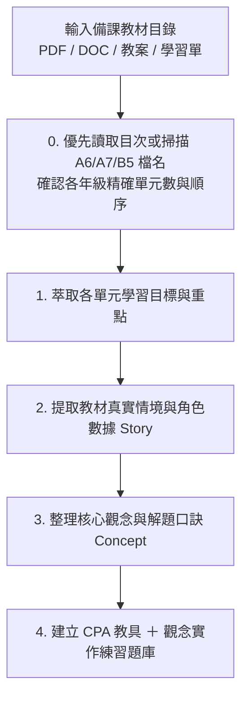

# 數學備課教材互動網頁化開發技能指引 (making_math_interaction.md)

本文件匯整自「木新思達國小 1~6 年級數學互動教學平台（**康軒版 57 單元 ＋ 南一版 56 單元 ＋ 翰林版 56 單元，共 169 個教學單元、845 份測驗卷、4,225 道互動題目**）」的完整實戰架構與開發經驗。本技能旨在提供 AI Agent 與教師/工程師在面對**任何年級、任何出版社（康軒、南一、翰林等）之新備課教材**時，能以標準化、模組化且具高度教學效能的方式，快速產出高互動性網頁並整合至現有系統中。

---

## 1. 核心教學設計理念：CPA 與「觀念＋實作雙引擎」

所有數學互動單元皆嚴格依據**新加坡數學與現代認知心理學的 CPA 教學法**，並配備**「上方 CPA 視覺教具 ＋ 下方觀念實作與隨堂互動練習實驗室」雙引擎**：

1. **Concrete（具體物操弄）**：
   - 學生必須能先操作「有形實物」或「虛擬教具」（如：拖拉萬以內積木、移動量尺、點選十格陣、旋轉時鐘指針、分配披薩切片、注水入量杯、圓規張開半徑畫圓、射擊固定靶統計周界內外部、料理秤指針秤重、串珠顏色規律排列）。
2. **Pictorial（圖像化表徵）**：
   - 透過幾何視覺化將操作轉化為圖像認知（如：雙折線圖與波浪省略線、百數表骰子展開圖、長方體 3D 透視圖與 6 面展開圖切換、數線跳躍、面積割補方格網、扇形幾分之幾圓量角器、乘以幾分之一動態面積縮放、兩量關係倍數連動表）。
3. **Abstract（符號化抽象）＆ 觀念實作練習（Interactive Practice Lab）**：
   - 引導至算式記錄、橫式運算、時間複名數直式乘除進退位、雞兔同籠列表推理或數學符號（支援 OMML / MathML 標準渲染）。
   - **每個單元 100% 內建「🎯 觀念實作與隨堂互動練習」**：提供「🛠️ 互動實作闖關（即時作答批改、換題練習）」與「📐 觀念拆解步驟尺（三步驟解題鷹架）」雙模式，確保學生在每個單元都能動手實作驗證觀念。

---

## 2. 備課教材解析與核心觀念萃取 SOP (Step 1)

當收到新學期、新出版社或新單元的備課教材資料夾（如康軒/南一課前診斷與單元學習單，或翰林 `A6_數學素養學習單`、`A7_主題式數學學習單`、`B5_數學8格練習卷` PDF/DOC 文件）時，執行以下五步解析：



### 2.1 備課目錄掃描與萃取必備要素
- **UTF-8 編碼防亂碼**：在 Windows PowerShell 掃描中文備課目錄前，務必先執行 `[Console]::OutputEncoding = [System.Text.Encoding]::UTF8`，避免中文檔名亂碼。
- **優先核對官方目次與結構**：
  - 南一版：優先讀取 `00_X上數學學習單目次.pdf`。
  - 翰林版（如 `D:\國小翰林\2.數學`）：掃描 `115上_國小數學備課資料(1~6年級)` 下各年級的 `A6_115上數學素養學習單`、`A7_115上主題式數學學習單` 與 `B5_115上數學8格練習卷`，精準確認各年級單元總數（例如：翰林版 1上 9單元、2上 9單元、3上 9單元、4上 10單元、5上 10單元、6上 9單元，共 56 單元）。
- **提取教材真實生活情境（3 組預設任務 ＋ 隨機出題）**：將備課學習單中的真實角色與數據轉化為情境按鈕：
  - **南一版範例**：「Follow Me 神射手棠棠射擊固定靶」、「小人國設計家圓規畫圓」、「湯基郎百數表骰子展開圖」、「南北溫差大雙折線圖」、「幸福動物園時間乘除」、「濃情巧克力表面積」。
  - **翰林版範例**：「烘培小達人料理秤（公斤與公克換算）」、「串珠設計師周期規律（餘數找顏色與列表推理）」、「烘焙坊與牧場縮放魔法（乘以幾分之一＝除以幾）」、「披薩與色紙折疊大師（扇形圓心角與幾分之幾圓）」、「文具團購與集點大作戰（兩量關係對照表）」、「生態園區解謎王（雞兔同籠列表法與追趕問題）」。
- **核心觀念解析點（Concept Points）**：2~3 點關鍵定義、算則原由或解題口訣。
- **反思性思考提問（Reflection Prompt）**：啟發學生思考「為什麼要這樣算？」而非單純背公式。

---

## 3. 多出版社三版本共構與仿三年級標準頁面架構 (Step 2)

### 3.1 單一網站多出版社雙軌架構（Shared + Custom Hybrid Mapping）
在同一網站中同時支援多個出版社版本（`📙 翰林版`、`📗 南一版`、`📘 康軒版`）時，採用**「共享底座 ＋ 專屬擴充 ＋ 全單元實作實驗室」架構**（實作於 `web/app_nanyi.js` 與 `web/app_hanlin.js`）：

1. **課綱共同單元（`type: 'shared'`）**：
   - 映射至現有高互動 CPA 教具區段（`refSec`），並在切換時先將原版標題與按鈕快取於 `origBannerCache`。
   - 動態將 `.unit-banner` 的標題、副標題（`bannerSub`）與測驗按鈕替換為目標出版社的單元順序、名稱與學習單情境描述；切回原出版社時從 `origBannerCache` 100% 無損還原。
2. **出版社獨有／特色單元（`type: 'custom'`）**：
   - 針對該出版社特有單元建立獨立 `<section id="ny_gX_unitY">` 或 `<section id="hl_gX_unitY" class="unit-section">` 與專屬渲染器（如 `renderNyGXUY()`、`renderHlGXUY()`）：
     - **南一專屬區段（6 個）**：`ny_g2_unit10`（平面圖形）、`ny_g3_unit9`（圓）、`ny_g4_unit7`（數量關係）、`ny_g5_unit1`（折線圖）、`ny_g5_unit9`（時間的乘除）、`ny_g5_unit10`（正方體和長方體）。
     - **翰林專屬區段（6 個）**：`hl_g3_unit7`（公斤與公克）、`hl_g3_unit9`（列表與規律）、`hl_g5_unit9`（乘以幾分之一）、`hl_g5_unit10`（扇形）、`hl_g6_unit5`（兩量關係）、`hl_g6_unit8`（怎樣解題）。
3. **首頁雙重版本入口與年級直達列（Header + `#publisherQuickEntryBar`）**：
   - 除了頂部 `header.top-header` 內的 `.publisher-switcher` 外，在 `</header>` 正下方設置醒目的 `#publisherQuickEntryBar`，提供三大出版社一鍵切換按鈕與「翰林 1上～6上」直達膠囊按鈕（呼叫 `quickEnterPublisherGrade(pub, grade)`），確保任何螢幕尺寸下一目了然。

### 3.2 仿三年級標準卡片 HTML 架構
為保證全站各版本、各年級、各單元有一致的使用者體驗與自適應排版，每個單元的 HTML 必須嚴格遵循**標準卡片結構**：

```html
<!-- 單元主容器：注意嚴禁在標籤加 style="display:none;" -->
<section id="hl_gX_unitY" class="unit-section">

  <!-- 1. 單元標題橫幅 (Banner) -->
  <div class="unit-banner">
    <div class="unit-banner-info">
      <h2>🎯 【翰林版 X上】第 Y 單元：單元名稱</h2>
      <p>結合教材素養學習單核心重點摘要與生活實踐目標！</p>
    </div>
    <div class="submode-switcher">
      <button class="btn btn-Amber" onclick="openHlUnitQuiz('X上', Y)">📝 參加翰林第Y單元測驗 (5份卷)</button>
    </div>
  </div>

  <!-- 2. 主工作卡片 (Workspace Card) -->
  <div class="workspace-card">
    
    <!-- 2.1 課本案例任務卡 (Story Prompt) -->
    <div class="story-prompt">
      <div class="story-text">
        <span class="story-badge">學習單情境任務</span>
        <span id="hlGXUYTaskText">【生活情境題目描述...】</span>
      </div>
      <div style="display:flex; gap:0.4rem; flex-wrap:wrap;">
        <button class="btn btn-Amber" onclick="setHlGXUYPreset(參數1, '情境說明A')">範例1：情境A</button>
        <button class="btn btn-Amber" onclick="setHlGXUYPreset(參數2, '情境說明B')">範例2：情境B</button>
        <button class="btn btn-Amber" onclick="setHlGXUYPreset(參數3, '情境說明C')">範例3：情境C</button>
        <button class="btn btn-primary" onclick="randomHlGXUYTask()">🎲 隨機出題</button>
      </div>
    </div>

    <!-- 2.2 核心觀念深度解析卡 (Concept Card) -->
    <div class="g6-concept-card" style="margin-bottom:1rem; padding:1rem 1.25rem;">
      <div class="g6-concept-title" style="font-size:1.05rem; margin-bottom:0.5rem;">
        💡 核心觀念：單元關鍵定義與解題口訣
      </div>
      <div style="font-size:0.95rem; color:#334155; line-height:1.7;">
        1. <strong>核心概念 1</strong>：具體說明與觀念原由。<br/>
        2. <strong>解題口訣 2</strong>：直觀記憶與邏輯推導。
      </div>
    </div>

    <!-- 2.3 具體教具互動操作區 (Manipulative Display) -->
    <div id="hlGXUYDisplay" style="margin-bottom:1rem;"></div>

    <!-- 2.4 啟發思考反饋提示橫幅 (Feedback Banner) -->
    <div class="feedback-banner success">
      💡 操作提示與思考提問：引導學生動手操作並深入思考本單元關鍵本質。
    </div>

    <!-- 2.5 全站通用：觀念實作與隨堂互動練習實驗室 (由 renderUnitPracticeLab 自動注入) -->
  </div>
</section>
```

---

## 4. 原生互動教具與「全單元觀念實作練習引擎」開發範式 (Step 3)

### 4.1 狀態機設計與隨機出題
每個年級或出版社建立獨立狀態物件（如 `g1State`, `g2State`, `nyState`, `hlState`）：
```javascript
const hlState = {
  g3u7: { kg: 1, g: 350, item: '香草蛋糕麵團', story: '...' },
  g5u10: { denom: 6, numer: 2, radius: 6, story: '...' }
};
```

### 4.2 全站通用「🎯 觀念實作與隨堂互動練習引擎 (`renderUnitPracticeLab`)」
為確保所有出版社（康軒、南一、翰林）的每一個年級、每一個單元都具備互動實作練習模式，於 `web/app_hanlin.js` 中實作 `renderUnitPracticeLab(secId, pub, grade, uNum)`，並在各版本單元切換函式（`switchUnit`, `switchG1Unit`~`switchG6Unit`, `switchNyUnit`, `switchHlUnit`）結尾自動呼叫：
- **動態題庫綁定**：自動對應當前出版社（`QUIZ_BANK_HANLIN` / `QUIZ_BANK_NANYI` / 康軒各年級題庫）之該單元題組。
- **雙模式切換**：
  1. `🛠️ 互動實作闖關`：提供選擇、是非、比大小、填空即時作答，答對獎勵 `⭐ +1` 並展開解析，支援「🎲 換一題實作」。
  2. `📐 觀念拆解步驟尺`：提供「步驟 1：審題抓關鍵數據 ➔ 步驟 2：套用核心觀念操作 ➔ 步驟 3：檢驗算式與答案」互動式拆解卡片。

---

## 5. 線上評量測驗卷規範與結構驗證 (Step 4)

每個單元編製 **5 份標準測驗卷**（每卷 5 題，每題 20 分，滿分 100 分）：
1. **第 1 卷：單元學前檢測卷**（診斷舊經驗與課前暖身）
2. **第 2 卷：基礎能力練習卷**（核心概念精熟，對應八格練習卷基礎題）
3. **第 3 卷：隨堂練習單**（課堂核心代表題，對應主題式學習單）
4. **第 4 卷：單元學後檢測卷**（單元綜合總評量）
5. **第 5 卷：數學素養與資優挑戰卷**（生活素養與進階應用題，對應 A6 素養學習單）

### 題庫結構範式（二維陣列：`bank[unitNum][paperIdx]`）
> ⚠️ 注意：`quiz.js` 讀取題目的標準路徑為 `bank[u][pIdx]`（其中 `u` 為單元編號 `"1"`~`"10"`，`pIdx` 為 `0`~`4` 的陣列索引），因此每個單元的題庫必須是包含 5 個子陣列的二維陣列。

---

## 6. 避坑防護與最佳實踐（Critical Anti-Patterns & Rules）

此部分為歷次跨年級與多出版社（康軒、南一、翰林）擴充及 Cloudflare Pages 部署時獲得的重大核心教訓，**所有開發者與 AI Agent 必須嚴格遵守**：

> [!CAUTION]
> ### 1. 嚴禁在 `<section>` 標籤加上行內樣式 `style="display:none;"`
> - **原因**：標籤上的 Inline Style 優先級為 1000，遠大於 CSS Class 規則 `.unit-section.active { display: block; }`（權重 20）。
> - 若寫上 `style="display:none;"`，即使 JavaScript 成功加入 `.active` 類別，**瀏覽器仍會強制隱藏整個單元**，導致畫面空白看不到教學內容！
> - **正確做法**：HTML 只宣告 `<section id="hl_gX_unitY" class="unit-section">`，並在切換時同步設定：
>   ```javascript
>   sec.classList.toggle('active', isTarget);
>   sec.style.display = (isTarget ? 'block' : 'none');
>   ```

> [!WARNING]
> ### 2. 跨檔案題庫與狀態變數的作用域陷阱（`const` / `let` vs `window`）
> - **原因**：在瀏覽器中，頂層宣告的 `const QUIZ_BANK_G1 = ...` 或 `let activePublisher = ...` **不會自動成為 `window` 物件的屬性**！
> - **正確做法**：
>   1. 定義端必須顯式掛載至 `window`：`if (typeof window !== 'undefined') window.QUIZ_BANK_HANLIN = QUIZ_BANK_HANLIN;`。
>   2. 跨檔案讀取端（如 `quiz_hanlin.js` 或 `quiz.js`）必須同時檢查詞法環境與 `window`。
>   3. `index.html` 的 `<script>` 載入順序中，衍生題庫（`quiz_nanyi.js`, `quiz_hanlin.js`）必須放在所有基礎題庫（`quiz.js`, `quiz_g1.js`, `quiz_g2.js`, `quiz_g5.js`, `quiz_g6.js`）**之後**載入。

> [!IMPORTANT]
> ### 3. 靜態資源 Cache-Busting 與 LocalStorage 版本遷移旗標
> - 所有引入的本機資源（CSS 與 JS）每次更新均需同步推進全站版本參數（如 `?v=20261112_hl2`）。
> - **LocalStorage 舊版本鎖定防護**：舊訪客的瀏覽器 `localStorage.getItem('kx_active_publisher')` 會記住上次造訪的版本（如 `'nanyi'`），導致新出版社上線後首頁仍顯示舊版本。必須在 `app.js` 的 `DOMContentLoaded` 加入一次性遷移旗標：
>   ```javascript
>   if (!localStorage.getItem('kx_hl_v2_ready')) {
>     localStorage.setItem('kx_active_publisher', 'hanlin');
>     localStorage.setItem('kx_hl_v2_ready', '1');
>   }
>   ```
> - 同時支援三維 URL 查詢參數直達路由：`?pub=hanlin|nanyi|kangxuan`、`?grade=1~6`、`?unit=1~10`。

> [!WARNING]
> ### 4. Cloudflare Pages 與 Wrangler 4.160+ 終極部署避坑規範（四大實戰鐵律）
> 1. **加密憑證 `default.enc` 版本相容性**：
>    - Wrangler `4.15x / 4.160+` 將 OAuth 登入憑證升級為 `C:\Users\<user>\AppData\Roaming\xdg.config\.wrangler\config\default.enc`（搭配 Windows Credential Manager `@napi-rs/keyring`）。舊版 `wrangler 4.135.0` 只讀取 `default.toml`，執行時會誤報 `Not logged in`。部署時務必呼叫支援 `default.enc` 的新版 Wrangler（如 `_npx` 快取中的 `wrangler 4.160.1`）。
> 2. **嚴禁在 `$HOME` (`C:\Users\<user>`) 根目錄執行 Wrangler（防止 `.wrangler` 遮蔽全域憑證）**：
>    - 若在 `C:\Users\<user>` 直接執行 Wrangler，程式會於當前目錄建立 `C:\Users\<user>\.wrangler\cache`。而 Wrangler 的 `getGlobalWranglerConfigPath()` 只要偵測到 `os.homedir() + "/.wrangler"` 存在，就會將其視為舊版全域設定目錄，**直接遮蔽（Shadow）真正存放 `default.enc` 的 `AppData\Roaming\xdg.config\.wrangler`**，導致瞬間報錯 `Not logged in / CLOUDFLARE_API_TOKEN required`！
>    - **防護措施**：若 `C:\Users\<user>\.wrangler` 存在且無 `config` 子目錄，先執行 `Remove-Item "$HOME\.wrangler" -Recurse -Force`，並永遠在獨立子資料夾（如 `C:\Users\<user>\cf_deploy_web`）中執行 Wrangler。
> 3. **避開 OneDrive 中文路徑與檔案鎖定**：
>    - 在 `OneDrive\文件\...` 內執行 `wrangler pages deploy` 常因 OneDrive 同步鎖定或非 ASCII 路徑造成程序在印出 Banner 後靜默退出。
>    - **標準做法**：將 `web/*` 複製至純英文路徑 `C:\Users\<user>\cf_deploy_web`，切入該目錄執行 `wrangler-dist\cli.js pages deploy . --project-name kangxuan-grade3-math --branch main --commit-dirty=true --commit-hash <hash> --commit-message "<ASCII message>"`，部署完成後清除暫存夾。
> 4. **防範 Cloudflare Pages SPA Fallback 假陽性驗證**：
>    - Cloudflare Pages 對不存在的靜態路徑（如尚未部署成功的 `/app_hanlin.js`）會自動 Fallback 回傳 `index.html` 且狀態碼為 `HTTP 200`！
>    - **正確驗證**：禁止僅用 `curl -I` 檢查 `200 OK`，必須檢查實際回傳內容：
>      ```powershell
>      curl.exe -s "https://kangxuan-grade3-math.pages.dev/?t=check" | Select-String "pubBtnHanlin"
>      curl.exe -s "https://kangxuan-grade3-math.pages.dev/app_hanlin.js" | Select-Object -First 5
>      ```

---

## 7. 部署、自動化驗證與收工標準流程 (End of Work SOP)

開發新單元、新出版社或修改現有架構後，必須按以下 5 步標準收工：

1. **語法與全題庫結構自動化驗證 (Syntax & Bank Integrity Check)**：
   ```powershell
   node --check web/app.js; node --check web/app_nanyi.js; node --check web/app_hanlin.js; node --check web/quiz.js; node --check web/quiz_nanyi.js; node --check web/quiz_hanlin.js
   ```
   並使用 Node `vm` 腳本驗證所有出版社、所有年級、所有單元的題庫皆滿足 `papers.length === 5`、每卷 `p.length === 5`、無空題目，且所有映射之 `<section id="...">` 均存在於 `web/index.html` 且無 inline `display:none`。
2. **多專案同步 (Sync Projects)**：
   - 將更新後之 `web/*`、`README.md` 與技能文件同步至 `Grade4` 與 `Grade3` 儲存庫。
3. **Git 提交與 GitHub 推播備份**：
   ```powershell
   git add .
   git commit -m "feat(scope): summary of changes"
   git push origin master
   ```
4. **Cloudflare Pages Production 純英文暫存區安全發布**：
   ```powershell
   Remove-Item -Path "$HOME\.wrangler" -Recurse -Force -ErrorAction SilentlyContinue
   New-Item -ItemType Directory -Force -Path "$HOME\cf_deploy_web" | Out-Null
   Copy-Item -Path "web\*" -Destination "$HOME\cf_deploy_web\" -Recurse -Force
   Set-Location "$HOME\cf_deploy_web"
   node "<wrangler_4_160_cli_path>" pages deploy . --project-name kangxuan-grade3-math --branch main --commit-dirty=true --commit-hash 5d9652c --commit-message "Deploy interactive curriculum"
   Remove-Item -Path "$HOME\cf_deploy_web" -Recurse -Force -ErrorAction SilentlyContinue
   ```
5. **生產主網址即時內容驗證（非僅檢查狀態碼）**：
   ```powershell
   curl.exe -s "https://kangxuan-grade3-math.pages.dev/?t=verify" | Select-String "pubBtnHanlin|publisherQuickEntryBar"
   curl.exe -s "https://kangxuan-grade3-math.pages.dev/app_hanlin.js" | Select-Object -First 5
   ```
